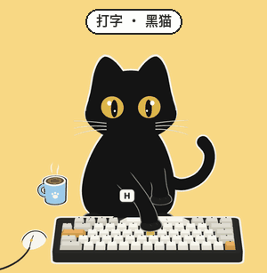

# KeyCat

一只趴在键盘上的桌面猫：你打字它伸爪按键，动鼠标它扭头看，摸头会呼噜，没人理会睡着，被烦到会用尾巴捶桌。支持 macOS 13+ 和 Windows 10+，除了从 GitHub 检查和下载更新，不联网。



下载页：<https://ellobodk.github.io/KeyCat/>，会按访问者的系统给出对应的安装包，页面上的猫可以直接用键盘鼠标逗。

## 安装

**macOS**：在终端执行

```sh
curl -L -o /tmp/KeyCat-macOS.zip https://github.com/ElloboDK/KeyCat/releases/latest/download/KeyCat-macOS.zip \
  && unzip -qo /tmp/KeyCat-macOS.zip -d /Applications && open /Applications/KeyCat.app
```

首次启动需在「系统设置 → 隐私与安全性 → 输入监控」里允许 KeyCat，然后重启应用。它只读取哪个键被按下，不记录输入内容。手动从浏览器下载时，若提示「已损坏」，执行 `xattr -dr com.apple.quarantine /Applications/KeyCat.app`。装在「应用程序」文件夹里的 KeyCat 会自动更新：启动 15 秒后和之后每 6 小时检查一次，有新版就在后台下载，退出时替换，也可以在菜单里点「重启并更新」。1.0.2 及更早的版本没有这个功能，需要用上面的命令重装一次。

**Windows**：从 [Releases](https://github.com/ElloboDK/KeyCat/releases/latest) 下载 `KeyCat-Windows-Setup.exe` 运行。SmartScreen 拦截时点「更多信息 → 仍要运行」。安装包只有几 MB，猫由系统自带的 WebView2 绘制，极少数没装 WebView2 的 Win10 会在安装时自动下载。KeyCat 装在 `C:\Program Files\KeyCat`，安装和每次自动更新都会弹一次 UAC（已经以管理员身份运行时不弹）。1.0.4 及以前装在用户目录里的旧版会自动升级过来并保留设置。

## 使用

猫住在菜单栏（Windows 是托盘）。右键猫或点图标打开菜单。最上面是番茄钟、今日小结和拍动图；「外观」管猫的样子（毛色、大小、眼睛、手套颜色（黑猫默认黑手套）、项圈等）；「桌面」管键盘颜色、鼠标线、桌上的杯子和透明度（猫挡住字时调低一点）；「习性」管多久睡着、呼噜声，在其中的「调节反应…」里选性格（高冷、粘人、暴躁、胆小），或者逐项调整烦躁、好奇、呼噜、休息提醒和番茄钟，底下的按钮可以让它当场演示各种动作。按住猫身体可以拖动位置。直播或录屏时可以打开「鼠标穿透」，点击会直接落到猫下面的窗口，猫照常显示和反应，这时菜单只能从菜单栏或托盘图标打开。

它自己也会找事做：闲着时会盯上旁边的杯子，看你一眼，举着爪子试探几下再推下去（推到一半被你动鼠标撞见，它会僵住，然后要么若无其事地收回爪子，要么当着你的面推下去）；睡醒会打哈欠、伸懒腰；睡着后太久没人理，就扑到键盘上趴成圆圆一团，两只前爪搭在键盘两头、脸埋在中间睡，睡熟了爪子还会抽动一下。摸头一会儿它会呼噜、踩奶（声音默认关，在菜单里打开）；双击猫头等于对它慢眨眼，它可能眨回来。几种快捷键它认得：连按退格会冒汗，保存会点头，复制时它把东西举在头顶，粘贴时放下。

照顾你的部分：连续工作 50 分钟左右，它会扑到键盘上提醒你休息：先撅着屁股、翘着尾巴盯住键盘，再整只趴下霸占键盘、圆眼睛看着你；你还要打字，它会举起一只爪子亮出肉垫拦你、眨一只眼；你停手一阵，它会眯起眼自己啪嗒啪嗒乱按几个键。离开一会儿或摸摸它（再给你 10 分钟）就会下来；深夜还在用电脑，它会犯困、催你睡觉；菜单里可以开始番茄钟，专注时它安静陪着。圣诞、万圣节、春节和你们认识的纪念日，它会换上帽子或围巾，冬天会缩成一团。几天没见面它会生闷气，摸一会儿就好。

菜单里的「今日小结…」显示今天按了多少键（每 300 下换一条小鱼干）、摸了几次、睡了多久、你们的关系到了哪一级，可以存成图片。「拍一张动图」录 3 秒 GIF。两种图片都存在「图片/KeyCat」文件夹。KeyCat 只记这些次数，不记按了哪些键。

「第二只猫」可以再养一只，两只会互相看、互相拍，也可以分工：一只打字，一只管鼠标。

Windows 上很多游戏以管理员身份运行，普通权限的 KeyCat 收不到发给它们的按键，猫就不动了。在菜单里打开「以管理员身份运行」，KeyCat 会弹出 UAC 授权并以管理员身份重启。开机自启这时改用计划任务，登录时直接以管理员身份启动，不弹 UAC；手动启动也会经由这个计划任务，同样不弹。计划任务只认装在 Program Files 里的 KeyCat，因为那个目录只有管理员能改，别的程序没法把它换掉再借计划任务拿到管理员权限；从别处运行的副本开机时照常弹 UAC。从 1.0.4 及以前升级上来后第一次启动会再弹一次 UAC，之后恢复不弹。没开开机自启时没有计划任务，每次手动启动都会弹 UAC。关掉这个选项后，要等 KeyCat 下次启动才恢复成普通权限。以管理员身份运行时，普通权限的程序按窗口抓不到猫（Windows 不让低权限程序读高权限窗口的画面），录屏请用整屏采集。独占全屏的游戏会盖住所有窗口，这种情况下猫本身就看不到，请把游戏改成无边框窗口模式。

## 构建

```sh
sh mac/build.sh       # → build/KeyCat.app（通用二进制，需 Xcode 命令行工具）
sh mac/package.sh     # → dist/KeyCat-macOS.zip + .sha256 + latest-mac.json

cd win && npm ci
npm start             # 本机调试
npm run dist          # → win/target/release/bundle/nsis/KeyCat_<版本>_x64-setup.exe（需 Rust 和 Node.js 22+，在 Windows 上执行）
```

mac 版用 `signing/` 里自动生成的本地证书签名，这样重新编译后「输入监控」授权仍然有效。mac 自动更新只接受同一张证书签名的新版，所以发布包必须在有这个目录的机器上打，证书丢了已安装的 mac 版也收不到更新。Windows 自动更新的签名私钥也放在这里（`tauri-updater.key` 和它的密码 `tauri-updater.password`），内容同时存在仓库的 `TAURI_SIGNING_PRIVATE_KEY`、`TAURI_SIGNING_PRIVATE_KEY_PASSWORD` 两个 Secret 里，公钥写在 `win/tauri.conf.json`。私钥丢了已安装的版本就收不到更新，要另外备份。不要提交这个目录。

## 发布

mac 和 Windows 共用一个 Release，两边产物都要上传，否则另一端的下载链接或自动更新会失效。

1. 把 `win/package.json` 的 `version` 和 `mac/Info.plist` 的 `CFBundleShortVersionString` 改成同一个版本，`CFBundleVersion` 加 1，合入 main。
2. 执行 `sh mac/package.sh`，推送 `vX.Y.Z` tag，再执行 `gh release create vX.Y.Z --generate-notes dist/KeyCat-macOS.zip dist/KeyCat-macOS.zip.sha256 dist/latest-mac.json`。`latest-mac.json` 是 mac 版的更新清单，mac 版靠 `CFBundleVersion` 判断新旧，所以每次发布都要加 1。
3. tag 触发 GitHub Actions，几分钟后会把 Windows 安装包、`latest.json`（新版的更新清单）和 `latest.yml`（让 1.0.x 旧版升级过来）补传到同一个 Release。

## 目录

```
mac/    macOS 外壳（Swift）：浮窗、菜单、键鼠监听、自动更新、构建/签名/打包脚本
win/    Windows 外壳（Tauri，Rust）：托盘、全局键鼠钩子、自动更新，页面由系统 WebView2 绘制
web/    两端共用的 three.js 场景：猫、键盘、动作，tuning.js 是可调参数和性格的唯一来源，life.js 是猫记住的东西，
        stats.html 是今日小结
site/   下载页，由 .github/workflows/pages.yml 连同 web/ 一起部署到 GitHub Pages，每 3 小时刷新一次下载量
tools/  开发用渲染脚本（serve.py 起本地服务，tour_gif.py 生成 README 里的功能总览动图，readme_gif.py 生成下载页的预览图，其余脚本在内置浏览器里截图对比）
```

## 说明

这是一个从零实现的学习项目，形象和交互参考了一款付费桌面宠物应用，仅供个人使用和内部交流，不用于商业分发，也不包含对方的任何素材。three.js 为 MIT 许可（见 `web/THREE_LICENSE`），Tauri 为 MIT / Apache-2.0 双许可。
